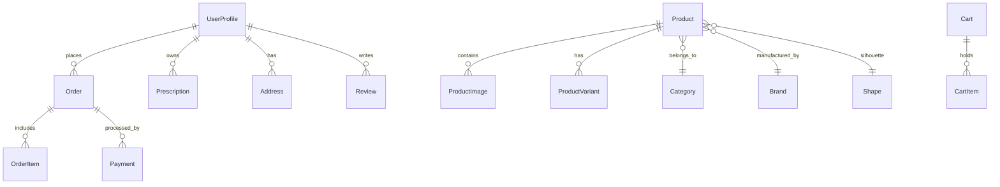

# LensCare Database Documentation

## 1. ORM & Configuration
- **ORM**: Prisma v7 (`@prisma/client`)
- **Database Engine**: PostgreSQL (Supabase hosted)
- **Config**: `prisma.config.ts` & `prisma/schema.prisma`

---

## 2. Entity Models & Relationships

### Models Overview
1. **UserProfile**: Linked to Supabase Auth UUID (`userId`), storing name, phone, role (`CUSTOMER`, `ADMIN`, `STAFF`).
2. **Product**: Core frame entity with SKU, dimensions (lens width, bridge width, temple length), prescription availability flag, price, sale price, stock, and preorder flags.
3. **ProductImage**: High-resolution image assets with order and primary flag.
4. **ProductVariant**: Color variants (color name, HEX color code, stock count).
5. **Brand**: Eyewear brand (Fusion, Vista, OptiLux, ClearView, LensAura, Novara) with country of origin.
6. **Shape**: Silhouette definition (Rectangle, Round, Cat Eye, Aviator, Geometric, Clubmaster, Square).
7. **Order & OrderItem**: Complete customer order tracking with shipping address snapshot, prescription lens config snapshot, status (`CONFIRMED`, `PROCESSING`, `SHIPPED`, `DELIVERED`).
8. **Prescription**: Optical power records storing Right Eye (OD) and Left Eye (OS) Sphere, Cylinder, Axis, Add, and Pupillary Distance (PD).
9. **Address**: Saved Bangladesh shipping destinations (Division, District, Thana, Street).
10. **Coupon**: Code, discount type (`PERCENT`, `FIXED`), minimum subtotal, expiry.

---

## 3. Seed Data
Seed data for 10 international brands, 7 frame shapes, and 15 curated optical frames and sunglasses is centralized in `src/lib/data/mockData.ts`. This serves as the development fallback and can be loaded directly into PostgreSQL via `prisma db seed`.
